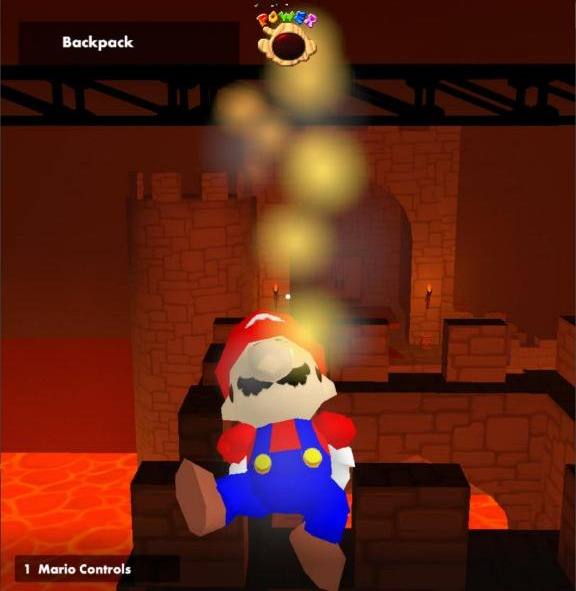
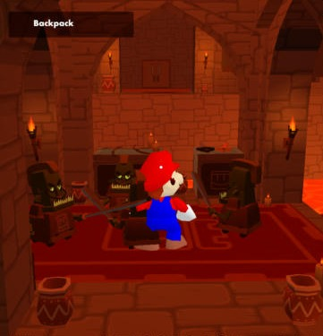
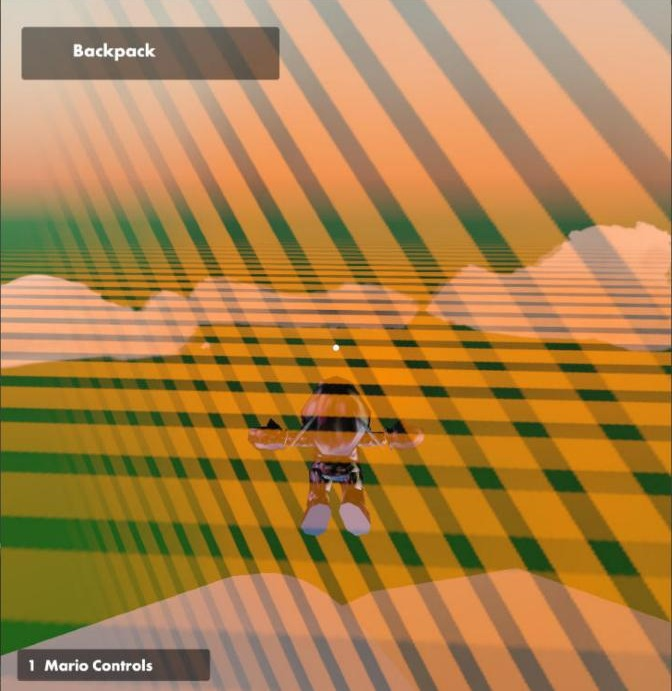
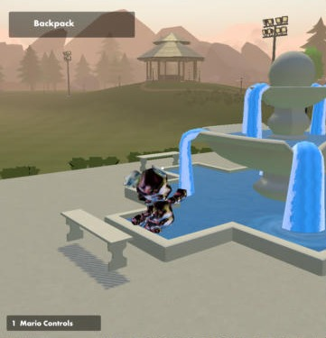

# Mario for Rec Room

**Super Mario 64's Mario in old IL2CPP builds of Rec Room (2019 to April 8, 2020). Offline, single player, real SM64 physics.**

**[Download the latest release](https://github.com/Shippy089/SM64-Mario_RecRoom/releases/latest)** · [Install guide](docs/INSTALL.md) · [Routes](docs/ROUTES.md)

by Shippy089

Click to watch on YouTube

> [!IMPORTANT]
> You have to bring your own **Super Mario 64 (USA) ROM** (the game's data, dumped from a cartridge you own) and your own copy
> of an **old IL2CPP Rec Room client (2019 to April 8, 2020)**. IL2CPP is the way those builds were compiled, and the mod
> loader only works with it. Neither one is included, nothing downloads them for you, and the mod never talks to Rec Room's
> servers.

Tested on the September 9, 2019 build. Other builds in the supported range can install, but not all of them are tested, and parts
of the mod may not fit them.

This repo has the docs, the routes and the native build scripts. The playable package is one zip on the
[Releases](https://github.com/Shippy089/SM64-Mario_RecRoom/releases) page, with the launcher, the mod, the native library and the
BepInEx loader inside.

## Gallery

<b>Screenshots and the Wing Cap video</b> (click to open)

 

<table>
<tr>
<td align="center" width="50%"> SM64 lava: the burn hop, fire puffs and the power meter</td>
<td align="center" width="50%"> Fighting goblins in a quest</td>
</tr>
<tr>
<td align="center" width="50%"> Wing Cap flight at the world edge (orange tape). Metal cap from the testing-only Immortal switch</td>
<td align="center" width="50%"> The Park. Metal cap from the testing-only Immortal switch</td>
</tr>
<tr>
<td align="center" colspan="2"> <b>Wing Cap showcase</b> (YouTube)</td>
</tr>
</table>

## What it is

It's the real Super Mario 64 Mario, running on [libsm64] (an open-source rebuild of SM64's movement), dropped into an old Rec
Room build. You can play in the Rec Center, the Park, the other rooms and whatever quests that build has. He moves like he did on
the N64: triple jumps, backflips, wall kicks, long jumps, dives, punches, ground pounds, the 8-wedge health meter and his voice.

I didn't change Rec Room itself. Same rooms, same enemies, same doors, same quest rules and scoring. Mario gets no special
treatment, so he has to beat the quests the way they were built.

It's offline and single player. No servers, no other players, no accounts.

## Features

You can start in the Rec Center or in any other room your client build has (the Park, the Bowling Alley, the paintball maps and
so on). You pick it on the **Map** tab. Some scenes are only a piece of a bigger room. For those, the log says so and the scene
doesn't load.

The quests work too: Golden Trophy, Jumbotron, Crimson Cauldron, Lost Skulls and Crescendo of the Blood Moon, as many as your
build has. Start from the beginning or from any room.

- **Combat.** His punches, kicks and stomps hurt Rec Room enemies, and their attacks hurt him. This only works in quests. The Rec
  Center and the other rooms have no fighting to hook into.
- **SM64 lava.** Mario burns, hops, loses health and smokes, instead of the quest ending the second he touches it. It's on by
  default (`sm64_lava`).
- **Carrying.** Buttons, pots, traps, bombs, torches, lighters, cannon handles, jigsaw pieces and floating pallets. He picks them
  up, carries them and throws them with his own grab.
- **Wing cap.** A triple jump turns into flight. He wears the cap whenever the original game lets you fly (the room allows it, or
  you hold the Maker Pen). You can also set it to always or never (`wing_cap`).
- **Constant flying** (toggleable, off by default). Mario flies at one steady speed. SM64's own flight speeds up in a dive and
  stalls in a climb.
- **World edge.** SM64's world is small, about **150 m** from where Mario starts, in every direction and up. A solid wall stands
  there. Orange construction tape fades in on it when you get within about 12 m.
- **Controllers.** Xbox, PlayStation and N64 USB adapters work, and so do other gamepads. They all use SM64's N64 layout
  ([button tables](docs/INSTALL.md)). Keyboard and mouse still work too.
- **Casual mode** (off by default). More reach and softer knockback, for when SM64 fights are too hard.
- **Routes.** JSON files (plain text files that list steps) that make Mario play by himself with controller input only. Nothing
  teleports him ([docs/ROUTES.md](docs/ROUTES.md)).

There's also a follow camera that you steer, SM64 sound, and SM64's power meter on screen. All of it is drawn from your ROM.

## Getting started

You need Windows 10 or 11 (64-bit), an **old IL2CPP Rec Room client (2019 to April 8, 2020)** and a **Super Mario 64 (USA) ROM**.
**BepInEx 6** is the mod loader, the tool that lets mods run inside a game. It's in the zip. The launcher has .NET built in, so
you don't install anything else. [docs/INSTALL.md](docs/INSTALL.md) says where to get each part, including how to download an
old build with SteamDB and DepotDownloader, and what the launcher checks. Allow about 15 minutes the first time.

1. **Unzip** the release into a folder you can write to, like Desktop or Documents. Not Program Files, and don't run it from
   inside the zip window.
2. **Double-click `Start-Mario.cmd`.** Windows may say it "protected your PC" because the launcher isn't code-signed. Choose
   *More info*, then *Run anyway*.
3. The first time, a **setup wizard** looks for the Rec Room client, your ROM and the BepInEx pack. It checks your Steam
   libraries, Downloads, Desktop, Documents and the folder next to the launcher, then lists what it found. Pick with Enter, or
   press **A** to accept everything and install. It only reads those files. It never downloads, copies or overwrites them. If it
   finds nothing, type the path yourself.
4. Press **P** (or **▶ PLAY**, then Enter). A *Hello Mario* loading bar follows the game while it starts, and Mario is there when
   it fills. **The first start takes a few minutes and needs the internet once**, because BepInEx downloads Unity's base files
   and gets itself ready for your client. Later starts take under a minute.
5. Play. W A S D moves, Space jumps, left click punches and grabs, Shift crouches, and the mouse turns the camera
   ([all controls](docs/INSTALL.md#controls-keyboard)). Esc pauses Mario's controls.

The launcher has tabs for the rest. Tab or 1 to 7 switches between them, and the arrow keys and Enter change things.

| Tab | What it does |
|---|---|
| Play | The Play button, what to start, Immortal Mario (testing only), and live status (health, room, position) |
| Map | The Rec Center, any other room of your client, or any room of the five quests, checked against your own build |
| Mario | Fighting, Casual mode, SM64 health meter, SM64 lava, carrying, Wing cap, constant flying, controller, camera, sound |
| Routes | Pick a route file for Mario to play by himself |
| Setup | Your file paths, a status check, set up / update, uninstall |
| Advanced | Start the quest right away, where logs go, and the flags Play would pass to the game |
| Log | Mario's live log while the game runs |

Mario only shows up when Rec Room is started from this menu. Each Play gives the game a one-time pass. If you start Rec Room any
other way (its own exe, a shortcut, copied flags), you get plain Rec Room and the mod stays off.

A few commands also work from a command line: `Start-Mario find` (shows what setup could use on this PC),
`Start-Mario setup --auto`, `Start-Mario check`, `Start-Mario stop` and `Start-Mario flags`.

## What's been tested

This is a work in progress by one person. Current status:

| Seen working in the game | Built and unit-tested, not proven in the game yet |
|---|---|
| Setup, Play and uninstall from the launcher, on a fresh install | Some rooms: 22 of the 28 tried start. The 6 StuntRunner courses are only parts of another room |
| Building the native library from a fresh libsm64 download | Carrying and placing objects (pallets) |
| Mario in the Rec Center: controls, camera, sound | Most quest routes (Jumbotron, Crimson Cauldron, Crescendo). A Golden Trophy route fight still times out |
| Starting in the Park with the Wing cap on | Finishing a whole quest with an S rank |
| Quests: start, fight, open doors, Mario in the next room | Game controllers: only the mapping tables, no real pad tried |
| Fighting goblins and taking damage | Builds other than the tested one (they install as *compatible build*) |
| Firing a cannon with the lighter (Lost Skulls) | |
| SM64 lava: burn hop, fire puffs, health loss, death ends the quest cleanly | |
| Constant flying, the Wing cap's wings, the orange world-edge tape | |
| Casual mode loading and punches landing | |

## Known limits

Any IL2CPP Rec Room build without anti-cheat can be installed. Anti-cheat is software that blocks changes to a game. Older builds
are either Mono (a different way of building Unity games) or IL2CPP on Unity 2018.1, and the mod can't load into those. Only the
September 9, 2019 build has been tested, so parts of the mod may not fit other builds. Builds with anti-cheat, and your live Steam
install, are always refused. The mod never works around anti-cheat.

SM64 uses 16-bit coordinates, so the world ends about 150 m from where Mario starts. Very large rooms get cut off by the
wall.

There's no online play, no other players, no accounts, and no scores sent anywhere. A run that starts mid-quest, or one with
Immortal on, isn't a full run.

A few scenes are only part of a bigger room and can't start on their own. The launcher lists every scene it finds, and the log
tells you when one can't be used.

It's Windows only, on a flat screen with a keyboard and mouse or a controller. No VR.

If loading stops or hangs, the loading bar says what went wrong in plain words. The full detail is in `BepInEx\LogOutput.log` in
the client folder (look for lines starting with `mario-`) and in `logs\<date>\player.log`.

## What isn't included

No Rec Room files, no Nintendo ROM data and no decompiled Rec Room code. You bring the client and the ROM, and setup only reads
them. BepInEx comes unmodified, with its licences (`BepInEx-pack\` in the release zip). The native Mario library in the zip is
built from the open-source [libsm64] code (see `NOTICE.txt` and `docs/VERSIONS.md`). It has no ROM data in it and reads your ROM
while the game runs. To build it yourself you need zig, a free compiler (`docs/INSTALL.md`).

The mod is MIT-licensed ([LICENSE.txt](LICENSE.txt)). Rec Room, Super Mario 64, libsm64 and BepInEx keep their own licences.

This is a fan project. Rec Room Inc. and Nintendo have nothing to do with it and don't endorse it. Check the terms of the games
you use before you share recordings or builds.

[libsm64]: https://github.com/libsm64/libsm64
